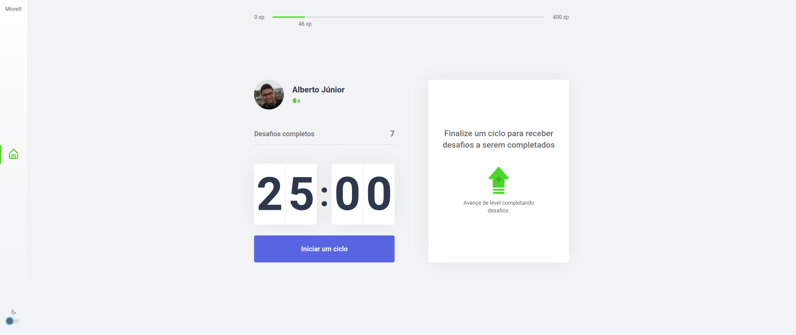

<h1 align="center">
  
</h1>

 Moveit
<p>
  
  <a href="#" target="_blank">
    
  </a>
  <a href="#" target="_blank">
    
  </a>
</p>
<div align="right">
Languages:
[Portuguese :brazil:](README-ptbr.md)
</div>
<p align="center">
  <a href="#-technologies">Technologies</a>&nbsp;&nbsp;&nbsp;|&nbsp;&nbsp;&nbsp;
  <a href="#-project">Project</a>&nbsp;&nbsp;&nbsp;|&nbsp;&nbsp;&nbsp;
  <a href="#-layout">Layout</a>&nbsp;&nbsp;&nbsp;|&nbsp;&nbsp;&nbsp;
  <a href="#-license">License</a>
</p>

## 💻 Project
This project is cronometer that use the pomodoro technique and at the end of each cycle the user receives a challenge, this challenges has the purpose of reduct the injuries for repetitive movement. That application was developed during NLW#4 - React Track, offered by Rocketseat over 5 days of marathon.

This application requires a permition to send notification, which need to be allowed by the user. It function ís notify the user the end of the cycle. In addition of this sound notification there is visual notification.

When the cycles focus ends, the user is informed by a new challenge and his points, case the user accomplish this poits will be summed bring him to the next level, otherwise, his level and experience will be the same.

For Each level advance are exhibited a modal with the new level achieved. If the page is update, the information will be recovered by the cookies.

## 🚀 Technologies
This Project was developed using the following technologies:
- ReactJS
- Next.js
- TypeScript
- js-cookie

## Tools
- VSCode
- Figma

## 🔖 Layout
Você pode visualizar o layout do projeto através [desse link](#).

## How to Use
If you want download this folder from this repository just follow this steps below:

1. Copy the url from your browser;
2. Replace the 'tree/main' or 'tree/master' with trunk;

Example: 
> https://github.com/User/somerepo/tree/main/folderyouwant
> https://github.com/User/somerepo/trunk/folderyouwant 

3.Go to the command Line and just grab the folder with SVN
```sh
    svn checkout https://github.com/User/somerepo/trunk/folderyouwant 
```

## Install
To use this application you have to download Node and run:
```sh
npm install 
```

## Usage
```sh
npm run dev
```

## Author
👤 **Alberto Junior**
* Github: [Alberto Júnior](https://github.com/wayfiding)
* LinkedIn: [Alberto Souza](https://linkedin.com/in/alberto-souza)

## 🤝 Contributing
Contributions, issues and feature requests are welcome!

## Show your support
Give a ⭐️ if this project helped you!

## 📝 License
Esse projeto está sob a licença MIT. 
---
Feito com ♥ by Rocketseat :wave: [Participe da nossa comunidade!](https://discordapp.com/invite/gCRAFhc)
***
_This README was generated with ❤️ by [readme-md-generator](https://github.com/kefranabg/readme-md-generator) and Alberto
