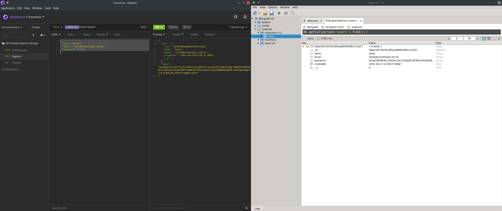
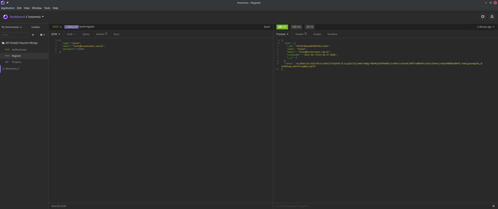
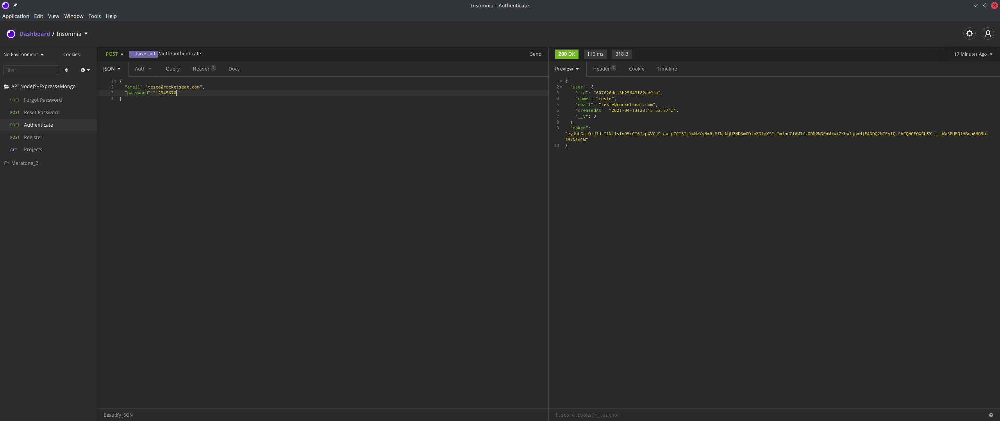

<h1 align="center">
  
</h1>

 API NodeJS + Express + Mongo
<p>
  
  <a href="#" target="_blank">
    
  </a>
  <a href="#" target="_blank">
    
  </a>
</p>
<div align="right">
Languages:
[Portuguese :brazil:](README-ptbr.md)
</div>
<p align="center">
  <a href="#-technologies">Technologies</a>&nbsp;&nbsp;&nbsp;|&nbsp;&nbsp;&nbsp;
  <a href="#-project">Project</a>&nbsp;&nbsp;&nbsp;|&nbsp;&nbsp;&nbsp;
  <a href="#-layout">Layout</a>&nbsp;&nbsp;&nbsp;|&nbsp;&nbsp;&nbsp;
  <a href="#-license">License</a>
</p>

## 💻 Project
On this project will be created an API REST from Zero with NodeJS, Express and MongoDB

### 🏠 [Homepage](https://github.com/Wayfiding/Rocketseat/tree/main/serie-node)

## 🚀 Technologies
This Project was developed using the following technologies:
- JavaScript
- NodeJS
- Express
- MongoDB
- bcrypt
- JWT
- Mongoose ODR

## Tools
- Insomnia
- VisualStudio Code
- Robo3T

## 🔖 Layout
Você pode visualizar o layout do projeto através [desse link](#).

## How to Use
If you want download this folder from this repository just follow this steps below:

1. Copy the url from your browser;
2. Replace the 'tree/main' or 'tree/master' with trunk;

Example: 
> https://github.com/User/somerepo/tree/main/folderyouwant
> https://github.com/User/somerepo/trunk/folderyouwant 

3.Go to the command Line and just grab the folder with SVN
```sh
    svn checkout https://github.com/User/somerepo/trunk/folderyouwant 
```

## Install
To use this application you have to download [Node](https://nodejs.org/en/), install de node.js and open the terminal on the current folder where you download theses files and run these command below.

```sh
npm init -y
npm install express 
npm install body-parser
npm install mongoose
npm install bcryptjs
npm install jsonwebtoken
npm install fs path
npm install nodemailer nodemailer-express-handlebars
```

## Usage
To test that application you gonna need to follow some steps so you can understand how this back-end app works. The Insomnia and Robo3T is required to test it.

Open your Insomnia on No Enviroment option select 'Manage Enviroments' and create a base url:

```json
{
  "base_url": "localhost:3000"
}
```
After that go back create a folder with name API NodeJS+Express+Mongo. 

And them Create 3 new Requests:

- Authenticate with Post 
- Register with Post
- Projects with Get

After that run this command to start the app :

```sh
node src/index.js
```

First you gonna register an account them you gonna authenticate and after that test the projects route.

 Register

 Authenticate

## Author
👤 **Alberto Junior**
* Github: [Alberto Júnior](https://github.com/wayfiding)
* LinkedIn: [Alberto Souza](https://linkedin.com/in/alberto-souza)

## 🤝 Contributing
Contributions, issues and feature requests are welcome!

## Show your support
Give a ⭐️ if this project helped you!

## 📝 License
Esse projeto está sob a licença MIT. 
---
Feito com ♥ by Rocketseat :wave: [Participe da nossa comunidade!](https://discordapp.com/invite/gCRAFhc)
***
_This README was generated with ❤️ by [readme-md-generator](https://github.com/kefranabg/readme-md-generator) and Alberto_
